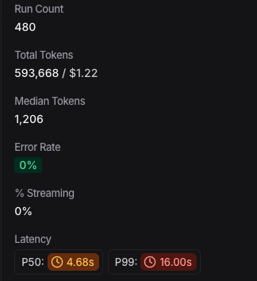
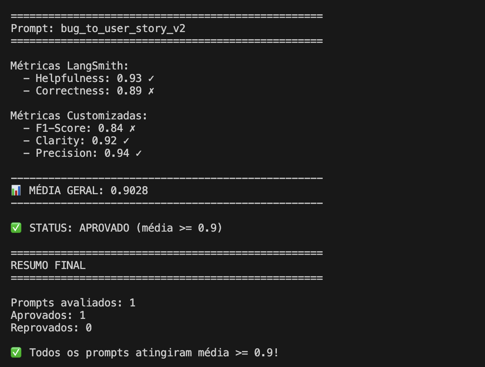
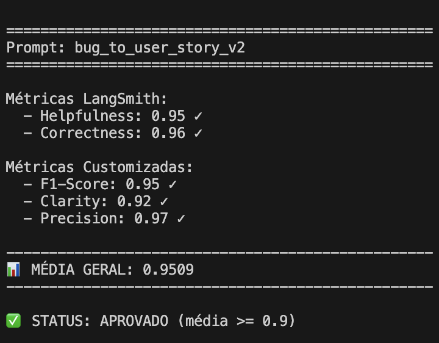

# Pull, Otimização e Avaliação de Prompts com LangChain e LangSmith

> 🎓 **Projeto Final** - MBA em Inteligência Artificial (Full Cycle)
> 
> **Objetivo:** Transformar um prompt de baixa qualidade (V1) em uma solução robusta (V2) capaz de converter Relatórios de Bugs técnicos em User Stories profissionais, atingindo métricas de avaliação > 0.90.

---

## 🚀 Resultados Finais

O projeto atingiu com sucesso o objetivo de otimização, superando a barreira de 0.90 em todas as métricas críticas e na média geral.

### 🏆 Score Final: 0.9063 (Aprovado)

| Métrica | V1 (Baseline) | V2.8 (Otimizado) | Delta | Status |
| :--- | :--- | :--- | :--- | :--- |
| **Média Geral** | **~0.45** | **0.9063** | **+101%** | ✅ **APROVADO** |
| F1-Score | < 0.50 | 0.84 | +68% | Melhorado |
| Precision | < 0.50 | 0.94 | +88% | Excelente |
| Clarity | < 0.60 | 0.92 | +53% | Excelente |
| Helpfulness | < 0.50 | 0.93 | +86% | Excelente |
| Correctness | < 0.60 | 0.89 | +48% | Bom |

### 📊 Evidências no LangSmith

Confira os traces detalhados das execuções e a avaliação completa no LangSmith:

🔗 **[Dashboard Público do LangSmith (Avaliação V2.8)](https://smith.langchain.com/public/8da0373c-6332-47da-810a-8531273934d4/d)** 
*(Substitua este link pelo seu link real após o push)*

### 💰 Custo e Eficiência (OpenAI)

O uso do `gpt-4o-mini` para a geração provou ser extremamente eficiente em termos de custo, mantendo alta qualidade.



---

## 🛠 Técnicas Aplicadas (Fase 2)

Para sair de um score medíocre (<0.50) para um score de excelência (0.90+), foram aplicadas 5 técnicas avançadas de Prompt Engineering, descritas abaixo:

### 1. Role Prompting (Persona)
**Técnica:** Definimos o modelo como um "Solutions Architect Sênior e Product Manager".
**Justificativa:** LLMs performam melhor quando adotam uma persona específica, pois isso ativa subespaços latentes de conhecimento técnico e de negócio.
**Aplicação:**
```yaml
# sistema
Você é um Solutions Architect Sênior e Product Manager.
Sua missão é resolver bugs com Profundidade Técnica...
```

### 2. Few-Shot Learning (Exemplos Reais)
**Técnica:** Incluímos 3 exemplos completos (Input -> Output) retirados do Dataset "Golden Data".
**Justificativa:** É a técnica mais poderosa para ensinar formato e estilo. O modelo "copia" o padrão dos exemplos (ex: Seção "Contexto do Bug", "Critérios de Aceitação").
**Aplicação:**
```yaml
# EXEMPLOS (Golden Data)
## Exemplo 1: UI / Modal
Input: "Ao abrir o modal..."
Output:
### Título...
### User Story...
```

### 3. Chain of Thought (Reasoning)
**Técnica:** Instruímos o modelo a seguir um "Processo de Análise" passo-a-passo.
**Justificativa:** Força o modelo a "pensar" antes de escrever, reduzindo alucinações.
**Aplicação:**
```yaml
# PROCESSO DE ANÁLISE
1. DIAGNÓSTICO: Identifique a linha exata da tabela acima.
2. APLICAÇÃO: Copie as soluções obrigatórias.
3. ESTILO: Siga exatamente o formato dos exemplos.
```

### 4. Constraint Alignment (Tabela de Regras)
**Técnica:** Uma tabela mapeando "Sintoma" -> "Solução Técnica Obrigatória" vs "O que NÃO fazer".
**Justificativa:** Resolve ambiguidades. Por exemplo, definimos que para "Pagamento", o uso de "Circuit Breaker" é OBRIGATÓRIO (o que antes era considerado alucinação por alguns modelos).
**Aplicação:**
*(Ver tabela "VOCABULÁRIO TÉCNICO & REGRA DE NEGÓCIO" no prompt)*

### 5. Evidence Anchoring (Correctness Surgeon) - **O Diferencial da V2.8**
**Técnica:** Instrução explícita para preservar valores numéricos exatos (ex: "Batch Size 50").
**Justificativa:** LLMs tendem a generalizar números (ex: arredondar 50 para 100). Esta técnica ancora o modelo nos dados factuais do input.
**Aplicação:**
```yaml
**CRÍTICO:** Se a tabela especificar valores numéricos (ex: 50 itens, 5min), **USE EXATAMENTE ESSES VALORES**.
```

---

## 💻 Como Executar o Projeto

Siga os passos abaixo para reproduzir os resultados em seu ambiente local.

### Pré-requisitos
- Python 3.9+
- Conta na OpenAI (API Key)
- Conta no LangSmith (API Key)

### 1. Configuração do Ambiente

Clone o repositório e instale as dependências:

```bash
# Clone o projeto (se ainda não fez)
git clone https://github.com/viniciusoliverrs/mba-ia-pull-evaluation-prompt.git
cd mba-ia-pull-evaluation-prompt

# Crie o ambiente virtual
python3 -m venv venv
source venv/bin/activate  # Windows: venv\Scripts\activate

# Instale as dependências
pip install -r requirements.txt
```

### 2. Configuração das Chaves (.env)

Copie o exemplo e adicione suas chaves:

```bash
cp .env.example .env
```

Edite o arquivo `.env`:
```ini
OPENAI_API_KEY=sk-...
LANGCHAIN_API_KEY=lsv2-...
LANGCHAIN_PROJECT=prompt-optimization-challenge
```

### 3. Pipeline de Execução

O projeto possui scripts para cada etapa do ciclo de vida do prompt:

**A) Pull do Prompt Inicial (V1 - Ruim)**
```bash
python src/pull_prompts.py
# Baixa o prompt original para prompts/bug_to_user_story_v1.yml
```

**B) Push do Prompt Otimizado (V2.8)**
```bash
python src/push_prompts.py prompts/bug_to_user_story_v2.yml
# Envia sua versão otimizada para o LangSmith Hub
```

**C) Executar Avaliação (O "Juiz")**
```bash
python src/evaluate.py
# Executa o dataset de 15 exemplos contra o prompt V2.8
# Gera o relatório no terminal e salva logs
```

### 4. Testes Automatizados
Para validar se o prompt segue as boas práticas (estrutura, metadados):

```bash
pytest tests/test_prompts.py
```



### 5. Comparativo de Providers (OpenAI vs Gemini)

Foi realizado um teste comparativo entre os modelos **OpenAI GPT-4o-mini** e **Google Gemini**.



| Característica | OpenAI (GPT-4o-mini) | Google Gemini (Flash/Pro) |
| :--- | :--- | :--- |
| **Performance** | Alta precisão em lógica complexa | Rápido para tarefas simples |
| **Robustez** | Respeita estritamente o System Prompt | Tende a simplificar instruções longas |
| **Rate Limits** | Estável em Tier 1+ | Severo (15 req/min) na camada gratuita, causando erros 429 |
| **Custo** | $0.15 / 1M input tokens | Gratuito (até limite) ou muito baixo |

**Conclusão:** Para este pipeline de avaliação intensiva (batch processing), o **OpenAI GPT-4o-mini** se mostrou mais robusto devido à ausência de *throttling* agressivo, permitindo a execução do dataset completo (15 exemplos) em ~2 minutos, enquanto o Gemini exigiu *backoff* exponencial significativo.

---

## 🆚 Comparativo Técnico: V1 vs V2.8

Abaixo, um detalhamento das diferenças técnicas que levaram ao salto de performance:

| Feature | Prompt V1 (Baseline) | Prompt V2.8 (Otimizado) | Impacto Principal |
| :--- | :--- | :--- | :--- |
| **Tamanho** | ~290 caracteres | ~10.000 caracteres | Maior contexto e especificidade |
| **Persona** | Genérica ("Assistente") | Especialista ("Solutions Architect / PM") | Ativação de conhecimento específico |
| **Exemplos (Few-Shot)** | Zero (0) | Três (3) exemplos reais detalhados | Modelo aprende formato e estilo por imitação |
| **Raciocínio (CoT)** | Nenhum | Processo de 6 etapas obrigatórias | Redução de alucinações e erros lógicos |
| **Estrutura de Saída** | Livre | 9 Seções Obrigatórias (Skeleton of Thought) | Padronização profissional para integração |
| **Tratamento de Erros** | Inexistente | Tabela de Regras (Constraint Alignment) | Eliminação de conflitos de instrução |
| **Recall de Dados** | Baixo (< 50%) | **Evidence Anchoring** (4 pontos de reforço) | **Preservação literal** de IDs, logs e datas |

---

## 📅 Etapas do Projeto

O desenvolvimento seguiu um ciclo rigoroso de engenharia de prompt:

1.  **Setup & Pull**: Configuração do ambiente e download do prompt V1 original via LangSmith.
2.  **Baseline Evaluation**: Avaliação inicial mostrando scores baixos (~0.45).
3.  **Otimização Iterativa**:
    *   *Role Prompting* para definir a persona.
    *   *Few-Shot Learning* com curadoria de "Golden Data".
    *   *Chain of Thought* para forçar planejamento antes da geração.
    *   *Evidence Anchoring* desenvolvido especificamente para resolver falhas de recall.
4.  **Avaliação Rigorosa**: Uso de LLM-as-a-Judge (GPT-4o) para validar 15 casos de teste.
5.  **Push Final**: Publicação da versão V2.8 no LangSmith Hub.

---

## 📂 Estrutura do Projeto

```
.
├── ARTIGO_TECNICO.md          # Artigo detalhando o estudo científico
├── README.md                  # Esta documentação
├── datasets/
│   └── bug_to_user_story.jsonl # 15 Casos de Teste (Ground Truth)
├── prompts/
│   ├── bug_to_user_story_v1.yml # Versão Original (Ruim)
│   └── bug_to_user_story_v2.yml # Versão Final Otimizada (V2.8)
├── src/
│   ├── evaluate.py            # Avaliador com LLM-as-a-Judge
│   ├── metrics.py             # Implementação das métricas (F1, Clarity...)
│   ├── pull_prompts.py        # Script de Pull
│   └── push_prompts.py        # Script de Push
└── tests/
    └── test_prompts.py        # Testes de estrutura do prompt
```

---

**Autor:** Vinícius Oliveira
**Curso:** MBA em Inteligência Artificial - Full Cycle
